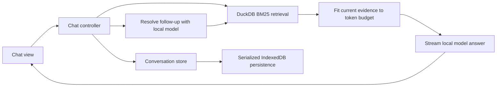

# RAGbox: Development Guide

RAGbox is a TypeScript application built with Vite. It uses React 19 views, Tailwind CSS and shadcn/ui controls, Zustand vanilla stores, DuckDB-Wasm for retrieval, and Transformers.js for local inference. Start with [installation](installation.md) to prepare a checkout and NFCorpus.

## Commands

Run commands from the repository root:

| Command | Purpose |
| --- | --- |
| `npm ci` | Install dependencies from the lockfile. |
| `npm run prepare:nfcorpus -- /path/to/corpus.jsonl` | Validate and prepare the static NFCorpus input. |
| `npm run dev` | Start Vite at `http://127.0.0.1:5173/` with a strict port. |
| `npm test` | Run the Node service/controller tests and React component tests once. |
| `npm run preview` | Serve the production build at `http://127.0.0.1:4173/ragbox/`. |
| `npm run test:e2e` | Run Playwright against an existing production build under `/ragbox/`. |
| `npm run typecheck` | Check application, worker, test, and Node-script TypeScript configurations. |
| `npm run build` | Run type checks and build `dist/` for the default root path. |
| `npm run build -- --base=/ragbox/` | Run type checks and build for the Pages subpath. |
| `npm test -- test/collection-retrieval.test.ts` | Run a focused test file. |

Vitest uses Node for service and controller tests and jsdom with React Testing Library for component tests. Browser APIs are represented with focused fakes where needed. Playwright exercises the actual Chromium OPFS implementation and the production bundle; DuckDB CDN URLs are fulfilled from the installed engine package, and model/GPU support is disabled in those checks to avoid weight downloads. Dependency versions are locked in `package-lock.json`; use the supported Node range in [package.json](../package.json).

## Request flow



The first message skips query rewriting. When no model is ready, the controller performs literal keyword retrieval and retains the results for inspection or a later answer. An empty result set produces an insufficient-evidence reply without answer generation.

For contextual follow-ups, the model receives bounded recent history and produces a standalone query. Retrieval then uses the selected saved index's analyzer and stopwords before a parameterized BM25 query. The answer worker fits the new evidence to its token budget, separates reasoning from final text, and reports allowed citation IDs. See [collections](collections.md#how-retrieval-works) and [the model guide](local-model.md#context-and-output-limits) for the actual limits.

## Source map

| Area | Files and responsibilities |
| --- | --- |
| Startup and navigation | [main.tsx](../src/main.tsx) creates one document-lifetime [AppRuntime](../src/runtime.ts), starts it once outside React effects, and mounts the React root. [navigation.tsx](../src/app/navigation.tsx) preserves query-string routes and Settings deep links. |
| UI and onboarding | [src/app](../src/app) contains Chat, Settings, History, the guide, confirmation dialogs, and the tour. Screen sections stay mounted during navigation. [src/components/ui](../src/components/ui) contains the used shadcn/ui primitives; `components.json` defines their aliases. |
| Styling | [style.css](../src/style.css) defines the light theme, Tailwind tokens, shell layout and animations. [duckdb-view.css](../src/duckdb-view.css) contains the guide illustrations and responsive layout. Public assets use the Vite base via `publicAsset`. |
| Collections and storage | [src/services](../src/services) contains DOM-independent NFCorpus preparation, MS MARCO download/opening, and scoped storage management. [collection-retrieval.ts](../src/collection-retrieval.ts) normalizes queries and executes BM25. |
| Database lifecycle | [open-local-database.ts](../src/open-local-database.ts) registers the database and WAL handles. [database-lock.ts](../src/database-lock.ts) coordinates tab ownership; [load-coordinator.ts](../src/load-coordinator.ts) serializes resource initialization. |
| Model and worker | [model-service.ts](../src/model-service.ts) manages capability checks, coordinated loading, cancellation, and inference. [llm-worker.ts](../src/llm-worker.ts) loads the pinned model and handles rewriting and generation. Model cache/readiness modules retain their existing identity and format. |
| Chat and persistence | [chat-controller.ts](../src/chat-controller.ts) handles attempts, retries, recovery, and stale events. [conversations.ts](../src/conversations.ts) and [conversation-persistence.ts](../src/conversation-persistence.ts) retain the existing Zustand and IndexedDB contracts. |
| Prompts and budgets | [rag.ts](../src/rag.ts), [generation-budget.ts](../src/generation-budget.ts), and [generation-output.ts](../src/generation-output.ts) preserve evidence fitting, output limits, and reasoning parsing. |

## State and lifecycle contracts

React consumes the existing Zustand stores with narrow selectors; the runtime reference is stable in context. Components do not create workers or database connections. Strict Mode remounts only UI subscriptions. `AppRuntime.start()` and `shutdown()` are idempotent; shutdown stops work and closes databases before releasing the Web Lock. `pagehide` flushes conversations without releasing a still-active database.

There is one active chat operation across the application. Conversation, turn, and attempt identities associate retrieval and worker events with their request. Late responses must be ignored after Stop, a collection change, New chat, or opening another conversation.

Runtime workers, database connections, and abort controllers live outside persisted state. Conversation reads are pure. Unchanged turns retain object identity, and selector subscriptions keep draft/control changes from rerendering the transcript. Equivalent resource snapshots are deduplicated. The controller observes resource transitions directly, so resuming pending work does not depend on a view rendering first.

Persistence preserves ordering, one-second streaming checkpoints, migration markers, and retention of 50 nonempty conversations. Reload must restore interrupted turns as Stopped and must not restart inference. Settings navigation preserves ongoing work; changing collections cancels it. Retries reuse the turn and its submitted effort while rerunning only the stages required by the failure.

Prompt evidence is untrusted data. Render document and model output as text, bind query values through prepared statements, and limit citation links to the fitted evidence IDs. Keep reasoning out of copy output and follow-up context. These contracts are covered by the existing test suites and [chat validation](chat-validation.md).

## Feature configuration

`HISTORY_ENABLED` in [src/features.ts](../src/features.ts) is currently `false`. Enabling it restores the History navigation link, page, and tour step; conversations persist in either mode. When following older validation notes, account for that flag and for thinking now being always off (the switch was removed).

`VITE_MSMARCO_INDEX_URL` changes the artifact URL at startup/build time. The expected size is a separate code constant. Model identity and revision are also code constants; changing them requires reviewing required cache files and template compatibility. See [deployment](deployment.md#configure-the-ms-marco-download) and [the model guide](local-model.md).

## Validation

For a normal change, run the checks relevant to the affected code. Before reviewing the full application or deployment path, use:

```sh
npm test
npm run typecheck
npm run build -- --base=/ragbox/
npx playwright install --with-deps chromium
npm run test:e2e
```

If a system Chromium is already installed, set `PLAYWRIGHT_CHROMIUM_EXECUTABLE_PATH=/absolute/path/to/chromium` instead of installing another browser. Browser screenshots and failure traces are written to the ignored `artifacts/playwright/` directory.

The build already runs type checking; the standalone command is useful for quicker diagnostics. Tests cover retrieval, orchestration, stale events, retries, model/cache recovery, reasoning parsing, token budgets, state subscriptions, persistence, and control behavior. Mocks cannot establish live answer quality or GPU compatibility.

For a supported-browser smoke check:

1. Prepare NFCorpus and verify retrieval and source inspection before loading the model.
2. With a real ready model, check an answer and a contextual follow-up, comparing factual claims with the cited snapshots.
3. Exercise Stop, Retry, draft editing, Settings navigation, collection switching, and reload restoration.
4. Check folded reasoning, copy output, source anchors, focus, scrolling, and a narrow viewport.
5. Exercise the built application under `/ragbox/` to catch worker and dataset path errors. Test MS MARCO when a valid artifact is already available or an explicit download is intended.

Use the detailed [existing checklist](chat-validation.md#repeatable-manual-checks) with its historical UI differences in mind. Run destructive storage checks only with disposable browser data. The [experiment notes](experiments.md) retain earlier scaling measurements; label new observations with browser, device, collection, and model revision instead of treating a single run as a benchmark.

[Documentation](README.md)
